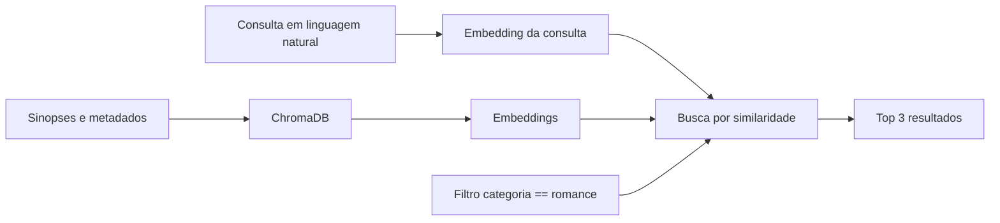

<div align="center">

# Busca Semântica com ChromaDB

Encontre filmes por significado, mesmo quando a consulta não repete as palavras da sinopse.

[](https://www.python.org/)
[](https://www.trychroma.com/)
[](https://jupyter.org/)

</div>

## Sumário

- [Sobre](#sobre)
- [Como funciona](#como-funciona)
- [Pré-requisitos](#pré-requisitos)
- [Execução](#execução)
- [O que o notebook demonstra](#o-que-o-notebook-demonstra)
- [Estrutura](#estrutura)

## Sobre

Este projeto apresenta uma implementação didática de busca semântica usando uma coleção de filmes dos anos 2000. Cada sinopse é transformada em um embedding e armazenada no ChromaDB junto com metadados como nome, gênero e categoria.

O notebook responde consultas em linguagem natural e retorna os três documentos mais próximos semanticamente. Também demonstra como combinar similaridade vetorial com filtros estruturados usando `where`.

## Como funciona



O fluxo principal é:

1. Criar a coleção `filmes_anos_2000`.
2. Inserir ou atualizar os 10 filmes com `collection.upsert`.
3. Consultar os documentos mais próximos com `collection.query`.
4. Exibir ID, sinopse, metadados e distância de cada resultado.
5. Restringir a busca por metadados, como `categoria == "romance"`.

> Quanto menor a distância retornada, maior a proximidade semântica entre a consulta e o documento.

## Pré-requisitos

- Python 3.10 ou superior
- Jupyter Notebook ou Visual Studio Code com a extensão Jupyter
- Ambiente virtual recomendado

## Execução

### 1. Clone o projeto e entre na pasta

```bash
git clone https://github.com/emanuel-batista/BuscaSemanticaCDB
cd BuscaSemanticaCDB
```

### 2. Crie e ative um ambiente virtual

No PowerShell:

```powershell
python -m venv .venv
.\.venv\Scripts\Activate.ps1
```

### 3. Instale a dependência

```bash
pip install chromadb
```

O próprio notebook também contém uma célula com `%pip install chromadb` para instalação pelo kernel selecionado.

### 4. Execute o notebook

Abra `buscasemantica.ipynb` no VS Code ou Jupyter e execute as células em ordem. O notebook mostra:

- a quantidade de filmes armazenados;
- a dimensão e uma amostra do embedding de um filme;
- três consultas semânticas com os três melhores resultados;
- uma consulta semântica filtrada pela categoria `romance`.

## O que o notebook demonstra

### Consultas semânticas

As consultas são formuladas com palavras diferentes das sinopses cadastradas, por exemplo:

```python
pergunta = "Moça começa a trabalhar no mundo fashion com uma chefe super exigente"
resultados = collection.query(query_texts=[pergunta], n_results=3)
```

### Filtro por metadados

É possível combinar a busca semântica com um filtro estruturado:

```python
resultado = collection.query(
    query_texts=["Casal improvável que acaba se apaixonando"],
    n_results=3,
    where={"categoria": "romance"},
)
```

### Escopo atual

- Dataset pequeno e definido diretamente no notebook.
- Cliente ChromaDB em memória, adequado para demonstração local.
- Sem API ou interface web.
- Embeddings gerados pelo mecanismo padrão do ChromaDB.

## Estrutura

```text
.
├── buscasemantica.ipynb  # Dataset, indexação e consultas
├── .gitignore             # Arquivos ignorados pelo Git
└── README.md              # Documentação do projeto
```

## Referências

- [ChromaDB](https://www.trychroma.com/)
- [Documentação de consultas do ChromaDB](https://docs.trychroma.com/docs/querying-collections/query-and-get)
- [Jupyter](https://jupyter.org/)
- Estrutura visual inspirada em [awesome-readme](https://github.com/matiassingers/awesome-readme)

<div align="center">

Feito para estudar embeddings, similaridade semântica e bancos vetoriais.

</div>